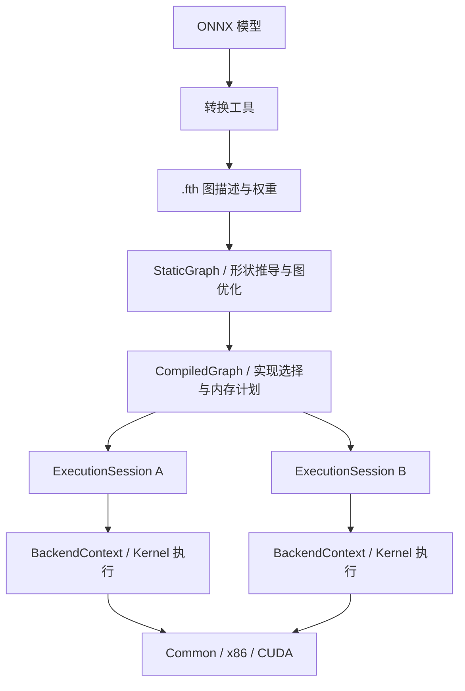

# Feather

**面向高性能、低资源占用与跨平台部署的 C++ 推理框架。**

Feather 致力于让更多模型在不同硬件上高效运行：以通用 CPU 算子保证可移植性，以平台专用 Kernel 提升计算性能，通过图优化、存储复用和低精度计算减少推理开销。

Feather 意为羽毛，呼应轻量、高效的设计目标。仓库地址为 `JPChen2000/Infer`，C++ 命名空间为 `feather`，CMake 库目标为 `infer`，模型文件扩展名为 `.fth`。

[快速开始](#快速开始) · [模型与算子](#模型与算子) · [C++ 接入](#c-接入) · [性能测量](#性能测量) · [开发方向](#开发方向)

## 设计目标

- **性能优先**：优化 Conv、GEMM、MatMul 等核心计算，结合布局、融合与调度降低整图耗时。
- **覆盖更多模型**：通过可扩展的算子注册、ONNX 转换和模型级测试，逐步扩展 CNN、检测与 Transformer 模型覆盖。
- **节省推理资源**：共享只读权重、按生命周期复用激活存储，并提供主机存储与设备临时工作区预算。
- **跨平台演进**：将算子语义、执行器与硬件实现分层，提供 Common 基线及 x86、CUDA 专用实现。

项目处于持续开发阶段。性能收益和模型支持以具体平台、模型、精度及测试结果为准。

## 当前能力

| 方向 | 已有实现 |
| --- | --- |
| 图执行 | 静态语义图、形状推导、图优化、不可变编译计划、独立执行会话 |
| 算子扩展 | Operator 注册、Kernel 候选筛选、能力检查、后端回退策略 |
| CPU 后端 | Common 通用实现；x86 AVX2/FMA/F16C 特化与运行时特性检测 |
| CUDA 后端 | CUDA Kernel、可选 cuBLAS/cuBLASLt/cuDNN 加速、会话独立上下文、执行捕获 |
| 精度 | FP32、FP16、BF16，以及部分算子的 FP8、INT8 路径 |
| 存储 | 权重映射、只读权重共享与写时复制、延迟分配、串行主机激活 arena |
| 模型工具 | ONNX → `.fth`、布局转换、INT8 校准与量化、结果比较 |
| 示例与测量 | 分类、YOLOv5、ViT、Qwen、FLUX.2 示例；算子 benchmark 与运行节点 profiling |

不同算子的 dtype、layout 和后端覆盖存在差异；支持一种数据类型不代表所有算子都有对应的原生实现。

### 平台状态

| 平台 / 后端 | 当前状态 |
| --- | --- |
| Linux x86-64 / Common、x86 | 当前主要开发与验证环境；支持关闭 x86 特化，使用 Common 基线 |
| ARM64 / Common | 保留通用执行与后端选择路径；尚无 ARM64 实机验收或 NEON 专用实现 |
| NVIDIA CUDA | 已有后端实现并完成 `sm_120` 构建；最新架构修改的 GPU 实机计算验收待完成 |
| 其他操作系统与加速设备 | 尚未建立完整支持与验收；设备枚举值或接口预留不代表已实现后端 |

## 快速开始

以下命令面向 Linux，均在仓库根目录执行。

### 1. 准备依赖

- 支持 C++17 的编译器。
- CMake 3.20 或更新版本。
- Python 3 与 **Conan 1.x**。当前构建脚本使用 Conan 1 API，不能直接使用 Conan 2。
- 默认启用 OpenMP；不需要时可设置 `-DFEATHER_ENABLE_OPENMP=OFF`。
- Google Benchmark；开启单元测试时还需 GoogleTest，均由 Conan 管理。
- Qwen 的 NFC tokenizer 需要 ICU 开发库（如 `libicu-dev`）；CMake 自动检测，FLUX.2 的具体准备步骤见 [文生图说明](docs/flux2.md)。

```sh
git clone https://github.com/JPChen2000/Infer.git
cd Infer

python3 -m venv .venv
. .venv/bin/activate
python -m pip install 'conan>=1.60,<2'
```

首次配置会下载 Conan CMake helper 并解析依赖，需要网络访问。当前依赖版本为 `benchmark/1.8.5` 和 `gtest/1.11.0`；离线构建需要提前准备匹配编译器和配置的 Conan 包缓存。

### 2. 构建 CPU 版本

```sh
cmake -S . -B build-cpu \
  -DCMAKE_BUILD_TYPE=Release \
  -DFEATHER_ENABLE_CUDA=OFF \
  -DBUILD_UNITTEST=ON
cmake --build build-cpu --parallel 4
ctest --test-dir build-cpu --output-on-failure
```

可执行文件位于 `build-cpu/bin/`。并行编译数可按本机资源调整。部分测试依赖外部模型、Python 包或 GPU，资源缺失时会明确跳过。

需要隔离验证 Common 路径时，使用独立构建目录：

```sh
cmake -S . -B build-common \
  -DCMAKE_BUILD_TYPE=Release \
  -DFEATHER_ENABLE_CUDA=OFF \
  -DFEATHER_ENABLE_X86=OFF
cmake --build build-common --parallel 4
```

在已包含 x86 特化的二进制中，也可通过 `FEATHER_DISABLE_X86=1` 强制走 Common 回退。

### 3. 转换模型并运行

先准备固定输入形状、算子和属性均受支持的 ONNX 模型：

```sh
python -m pip install numpy onnx
mkdir -p models
python tools/onnx_to_feather.py \
  --input /path/to/yolov5n.onnx \
  --output models/yolov5n.fth \
  --layout nchw

build-cpu/bin/yolov5_demo \
  --model models/yolov5n.fth \
  --image /path/to/image.jpg \
  --backend host \
  --output output.jpg
```

将 `/path/to/...` 替换为实际文件路径；模型权重和示例图片需自行准备。ONNX 转换工具不保证兼容任意模型或 opset，导出方式、输入形状和算子属性都会影响兼容性。

`--backend host` 自动选择宿主 CPU 路径；`common` 用于通用基线，`x86` 请求 x86 实现。缺少匹配实现时可能回退 Common；核心接口可通过 `KernelFallbackPolicy::kRequireRequested` 禁止回退。

### 可选：构建 CUDA 版本

需要匹配的 NVIDIA 驱动与 CUDA Toolkit。以下架构值 `120` 用于 RTX 5090，其他设备需替换为对应值：

```sh
cmake -S . -B build-cuda \
  -DCMAKE_BUILD_TYPE=Release \
  -DFEATHER_ENABLE_CUDA=ON \
  -DCMAKE_CUDA_ARCHITECTURES=120 \
  -DBUILD_UNITTEST=ON
cmake --build build-cuda --parallel 4
build-cuda/bin/cuda_diagnostics
```

配置结束时确认输出中的 `cuda: ON`；开启选项但未找到 CUDA 编译器时，构建会退回 CPU。CUDA 构建成功不代表设备计算验证通过。驱动库匹配、显存条件与诊断入口见 [CUDA 运行与排障](docs/cuda_runtime.md)。

## 模型与算子

项目通过 ONNX 转换工具生成 `.fth`，C++ 运行时加载 `.fth` 中的图描述和权重。

| 模型方向 | 示例 / 工具 | 使用范围 |
| --- | --- | --- |
| CNN 分类 | `resnet_demo`、`repvgg_demo`、`tools/download_classification_models.py` | 已适配的分类模型导出图 |
| 目标检测 | `yolo_demo`、`yolov5_demo`、`yolov5_benchmark_demo` | YOLOv5 兼容入口及 YOLOv6/v8/v10/11/26 nano 检测图；[导出、输出契约与运行命令](docs/yolo_detection.md) |
| 视觉 Transformer | `vit_demo`、`tools/export_vit_model.py` | 固定形状导出；部分聚合算子展开为基础算子 |
| 文本与状态推理 | `qwen_demo`、`tools/export_qwen35_optimized.py`、`tools/export_qwen35_model.py`、`tools/export_transformer_models.py` | 指定导出配置，含通用状态更新与模型专用优化 |
| 文生图 | `flux2_demo`、`tools/export_flux2_model.py` | FLUX.2 Klein 4B 四步蒸馏版，固定形状、FP32/BF16、纯 C++ 分阶段执行；[权重、导出、运行与验证边界](docs/flux2.md) |

Qwen 的 `--fp8-format e4m3|e5m2` 导出使用混合精度：主要线性投影的权重、输入和结果使用 FP8；embedding/共享输出头、深度卷积权重及小型 a/b 循环控制投影保留原始 BF16 权重和接口。残差、MLP 激活与最终 logits 使用 BF16，循环状态更新与归一化规约使用 FP32。此前未保留这些权重的 FP8 模型需要重新导出，例如：

```sh
python3 tools/export_qwen35_model.py \
  --model-dir models/llm/qwen3.5-0.8b \
  --fp8-format e5m2 --default-context 4096
```

Qwen 新导出的 FTH v4 模型只需导出一次，可在加载时选择上下文容量：

```sh
./build_new/bin/qwen_demo \
  --model models/llm/qwen3.5-0.8b/qwen3.5-0.8b_decode_fp8e5m2.fth \
  --tokenizer models/llm/qwen3.5-0.8b --backend cuda \
  --context-size 2048 --max-new-tokens 512 --prompt '介绍一下你自己'
```

`--context-size 0`（默认）从导出默认容量开始，带上下文元数据的模型按需自动扩容，导出器默认起始容量为 4096；正数值设置应用的硬容量上限，`--max-context` 是兼容别名。容量包含 system、历史、当前输入、输出及轮次结束标记，扩容始终受原模型配置上限约束。C++ 的 `QwenRunner::ReserveContext()` 可显式请求容量；扩容通过准备并替换形状计划完成，保留 KV 前缀、卷积及循环状态，失败时保留原会话。旧版固定容量文件仍可加载，改变容量需要重新导出。

`--max-new-tokens` 默认 512，`-1` 表示不限生成预算，仍会在 EOS、上下文耗尽或取消时停止。输出中的 `finish_reason` 区分 `eos`、`length`、`context_limit`、`cancelled`。不提供 `--prompt` 时进入逐行多轮对话，保留 system 和最近的完整轮次；默认自动扩容模式先为历史、新输入、生成预算和结束标记申请容量；达到模型上限或使用显式容量后，空间不足时丢弃最旧完整轮次，重置全部状态并重放保留的精确 token。单条输入自身超过可用上限时明确报错。多轮模式为结束标记预留容量，所以实际可生成 token 数略小于剩余容量。

`tools/export_qwen35_optimized.py` 导出一个 FTH v4 文件，包含一份权重和一个带显式序列维度绑定的图，默认序列长度为 1；`--prefill-chunk` 配置提示块上限，默认 16。runner 从同一图按需缓存 1、2、4、8 等长度的执行计划，余数使用较小计划组合而无需 padding。各计划共享同一组可变状态、只读权重和 CUDA 执行上下文；切换长度无需传递 KV 或循环状态。旧 v1–v5 模型文件保留加载兼容。通用 RMSNorm/LayerNorm、bilinear Resize 与实际精度、性能、显存边界见 [主流模型推理路径](docs/mainstream_inference.md)。

逐 token 困惑度、正常生成延迟、E4M3 范围校准和敏感投影 BF16 保留策略见 [Qwen 评测与校准](docs/qwen_evaluation.md)。文档保留 BF16/FP8 实测对照和数据范围限制。

以上表示仓库已有入口，不表示对应模型家族的任意版本都已支持。分类示例的调用方式为：

```sh
build-cpu/bin/resnet_demo \
  --model /path/to/resnet.fth \
  --image /path/to/image.jpg \
  --backend host --top-k 5
```

算子覆盖卷积与矩阵计算、逐元素计算、激活、池化、规约、索引、形状与布局操作，以及量化和模型专用算子。新增算子通常涉及：

1. 在 `src/operator/` 实现语义、属性解析、形状检查与注册。
2. 在 `src/kernel/common/` 提供通用正确性基线。
3. 根据热点在 `src/kernel/x86/` 或 `src/kernel/cuda/` 添加专用实现。
4. 增加算子数值对照和模型级回归。

历史 [算子支持表](docs/operator_support_matrix.md) 可用于了解分类，但其统计日期较早；当前覆盖以算子注册、Kernel 能力约束和对应测试为准。

## C++ 接入

推荐使用 `StaticGraph → CompiledGraph → ExecutionSession`。下面构建一个不依赖外部模型的 `y = x + bias` 图，演示编译、输入绑定和执行：

```cpp
#include <cstdlib>
#include <iostream>
#include <memory>
#include <vector>

#include "core/execution_plan.h"

int main() {
    using namespace feather;
    const auto check = [](const Status& status) {
        if (!status.ok()) {
            std::cerr << status.message() << '\n';
            std::exit(EXIT_FAILURE);
        }
    };
    const auto tensor = [](std::vector<float> data) {
        auto value = std::make_shared<Tensor>();
        value->Assign<float>(data, {4});
        return value;
    };

    model::ModelDesc model;
    model.graph.inputs = {"x"};
    model.graph.outputs = {"y"};
    for (const auto* name : {"x", "bias", "y"}) {
        model::ValueDesc value;
        value.tensor.name = name;
        value.tensor.dims = {4};
        value.tensor.data_type = DataType::FP32;
        value.constant = value.tensor.name == "bias";
        model.graph.values.push_back(value);
    }
    model::NodeDesc add;
    add.name = "add";
    add.op_type = "Add";
    add.inputs = {"x", "bias"};
    add.outputs = {"y"};
    model.graph.nodes.push_back(add);

    StaticGraph graph;
    graph.SetKernelDevice(DeviceType::COMMON);
    if (graph.SetModel(model) != 0 ||
        graph.SetTensor("x", tensor({0, 0, 0, 0})) != 0 ||
        graph.SetTensor("bias", tensor({1, 1, 1, 1})) != 0) return 1;
    check(graph.BuildStatus());
    check(graph.ApplyPassesStatus());

    std::shared_ptr<const CompiledGraph> compiled;
    check(CompiledGraph::Compile(graph, &compiled));
    std::unique_ptr<ExecutionSession> session;
    check(compiled->CreateSession(&session));
    check(session->BindInput("x", tensor({1, 2, 3, 4})));
    check(session->Run());

    std::shared_ptr<Tensor> output;
    check(session->ReadOutput("y", &output));
    for (int i = 0; i < 4; ++i) std::cout << output->data<float>()[i] << ' ';
    std::cout << '\n';  // 2 3 4 5
}
```

源码树内的 CMake 消费目标可通过 `target_link_libraries(your_app PRIVATE infer)` 接入。

同一 `CompiledGraph` 可以创建多个独立会话，共享只读权重；每个会话独立持有可变 Tensor、Kernel 和后端上下文。不同会话可并发，同一会话的绑定与执行需由调用者串行化。`BindInput` 当前将输入复制到会话存储；输出内容保证有效至下一次执行前，如需长期保存应自行复制。

## 执行架构



- **StaticGraph**：维护语义与依赖关系，执行形状推导、图校验及优化 Pass。
- **CompiledGraph**：保存固定形状的参数快照、选定 Kernel 工厂和存储生命周期计划。
- **ExecutionSession**：实例化执行资源，管理输入、输出与可变状态。
- **Storage / Tensor**：分别管理存储所有权与张量描述、视图、偏移和量化信息。
- **BackendContext**：隔离设备能力、传输、同步、工作区与执行捕获。

当前激活 arena 用于串行主机会话；图并行和 CUDA 会话使用独立分配。编译计划固定 shape，改变输入形状需要重新编译。完整契约见 [执行架构说明](docs/execution_architecture.md)。

## 性能测量

### 模型级 benchmark

```sh
build-cpu/bin/yolov5_benchmark_demo \
  --model models/yolov5n.fth \
  --image /path/to/image.jpg \
  --backend host \
  --benchmark_min_warmup_time=1 \
  --benchmark_min_time=3s \
  --benchmark_repetitions=5 \
  --benchmark_out=yolov5-benchmark.json \
  --benchmark_out_format=json
```

该入口在计时前加载模型并解码图片，循环调用 `RunPreparedImage`；测量包含图像预处理、推理和检测后处理，不含模型加载、文件读图与结果图片保存。纯执行图耗时需要结合节点 profiling 和其他测量单独分析。

单次诊断可在 `yolov5_demo` 或分类示例中添加 `--profile`，查看节点与算子耗时。性能比较应固定模型、输入形状、精度、线程配置和硬件环境，并区分首次运行、预热后运行与端到端耗时。

### 内存复用示例

```sh
build-cpu/bin/execution_plan_benchmark
```

该程序比较 32 个 Add 节点在开启、关闭激活复用时的规划存储，并校验全部输出。已有 x86-64 Release 测量中，可变 Tensor 主机存储从 **8,650,752 字节降至 786,432 字节，约减少 90.9%**。这是合成图的规划存储结果，不代表实际模型的进程 RSS、峰值显存或加速比例。

## 测试

```sh
# 完整测试入口
ctest --test-dir build-cpu --output-on-failure

# 单独运行架构与安全回归
build-cpu/bin/unit_tests \
  --gtest_filter='execution_plan_test.*:runtime_safety_test.*'
```

需要 ONNX 参考对照时，安装 `numpy`、`onnx`、`onnxruntime`。可使用 `FEATHER_TEST_PYTHON` 指定解释器，使用 `FEATHER_YOLOV5_MODEL` 指定已有 YOLOv5 模型资源。

2026-10-21 的 Linux x86-64 验证中，CPU 完整套件为 **493 项通过、47 项跳过、0 项失败**，全量 CPU ASan/UBSan 检查未报告错误。跳过项包括依赖 GPU 或缺失可选模型的测试。

## 开发方向

近期工作围绕性能、模型覆盖和资源效率展开：

- 建立 CNN、检测、视觉与文本 Transformer 的模型基线，按导入缺口扩充算子与属性语义。
- 优化 Common / x86 高频算子，并用模型级结果验证收益。
- 减少临时分配、重复权重打包、布局转换与数据复制，完善实际内存统计。
- 协调会话并发、图并行和算子内部并行，控制线程与执行资源。
- 完善低精度整图路径，联合评估误差、耗时和存储开销。
- 保持 ARM64 源码可移植性，后续补充交叉编译检查和实机优化；CUDA 实机验收后续安排。

符号动态 shape、CUDA 全局激活规划、多设备调度与自动代价模型尚未实现。

## 目录与文档

```text
include/       公共接口：Tensor、图、会话、后端与模型加载
src/core/      存储、编译计划、执行图与状态管理
src/operator/  算子语义、属性解析与形状推导
src/kernel/    Common、x86、CUDA 实现与后端适配
src/pass/      通用与模型专用图优化
src/model/     模型格式、权重映射与布局转换
src/quant/     静态量化
demo/          推理示例与 benchmark
tools/         转换、导出、量化与诊断工具
test/          算子、模型、架构与安全回归
docs/          设计与验证记录
```

- [执行架构与会话契约](docs/execution_architecture.md)
- [运行时安全与资源所有权](docs/runtime_safety.md)
- [CUDA 运行与排障](docs/cuda_runtime.md)
- [项目总览（含历史设计背景）](docs/project_overview.md)
- [开发路线图（含历史阶段规划）](docs/development_roadmap.md)

欢迎提交带有复现模型、输入形状、平台信息与测量结果的 Issue 或 Pull Request。算子扩展应包含数值对照，性能优化应同时说明测量条件、精度误差和模型级收益。

## 许可证

Feather 的原创代码与文档采用 [Apache License 2.0](LICENSE)，允许商用、修改和再分发，并提供明确的专利授权。版权与归属信息见 [NOTICE](NOTICE)。

第三方组件、模型权重与测试图片遵循各自的许可证，详见 [第三方声明](THIRD_PARTY_NOTICES.md)。

项目自有源码使用统一的版权声明、`SPDX-License-Identifier: Apache-2.0` 标识和 Apache-2.0 授权文件头；新增源码应沿用这一格式。第三方源文件保留各自原有的版权与许可证声明。
